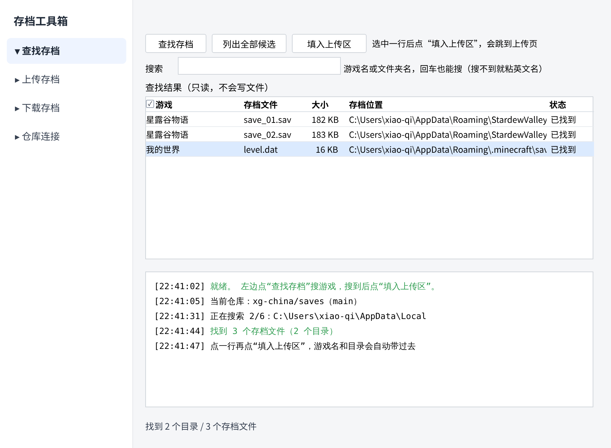

# 存档工具箱 · 游戏存档本地 ↔ 自己的 GitHub

查存档、上传、下载、还原，全在一个窗口里。零依赖，不注册任何账号，存档存在**你自己的** GitHub 仓库里。



## 它能干什么

| 场景 | 操作 |
| --- | --- |
| 不知道游戏存档藏在哪 | 输入游戏名，自动扫描 `AppData\Roaming`、`LocalLow`、`Saved Games`、文档、Steam 库 |
| 想给存档做个异地备份 | 选中文件，一键传到你的 GitHub 仓库，按游戏分文件夹 |
| 换电脑 / 重装系统 | 点“预览”看会还原到哪，再点“开始还原”，覆盖前自动备份 |
| 存档被覆盖了 | 从 `备份\<游戏名>\<时间戳>\` 把原文件拷回去，或从仓库重新拉一遍 |
| 云端存档不想要了 | 下载页点「清除云存档」，整个 `存档/<游戏名>/` 从仓库删掉，一次删一条提交，本地文件不动 |

## 下载与安装

1. 到 [Releases](../../releases) 下载 `save-toolbox-v1.0.22.zip`
2. 解压到固定目录（例如 `D:\工具\存档工具箱`），**不要**放在 Temp 或桌面随手丢——备份文件夹跟着程序目录走
3. 双击 `save-toolbox.exe`，直接出窗口，没有黑色命令行

首次运行 Windows 可能提示“未知发布者”，点“更多信息 → 仍要运行”；或右键 exe → 属性 → 勾“解除锁定”。

## 文件清单

| 文件 | 作用 |
| --- | --- |
| `save-toolbox.exe` | 启动器，双击它（带图标） |
| `save-toolbox.ps1` | 程序主体，必须和 exe 同目录 |
| `说明.txt` | 完整说明，含 Token 申请步骤与全部 FAQ |
| `令牌申请步骤.png` | 令牌申请图文步骤（点哪点哪都标好了） |
| `config.txt` | 第一次运行自动生成，不用手动带 |

## 仓库结构

```
存档/<游戏名>/<存档文件>
存档/<游戏名>/meta.json   记录游戏名、原路径、文件清单、更新时间
README.md                首页表格，上传时自动更新
```

## 配置（只做一次）

左侧「仓库连接」填三个空：

- **用户名 / 仓库**：`你的用户名/仓库名`，例如 `XQ-China/saves`
- **分支**：一般就是 `main`（填分支名，不是仓库名）
- **Token**：只下载公开仓库可以留空（每小时 60 次请求上限）；上传必须填

> Token 申请（只勾 `repo`）：头像 → **Settings**（设置）→ 左侧最底 **Developer settings**（开发者设置）→ **Personal access tokens**（个人访问令牌）→ **Tokens (classic)**（令牌·经典）→ **Generate new token (classic)** → 到期选 **No expiration** → 只勾 **repo** → 生成。图文步骤见 [`令牌申请步骤.png`](令牌申请步骤.png)。
>
> 仓库设成私有后，**下载也必须带 Token**，否则会 404。

## 常见问题

| 现象 | 原因 |
| --- | --- |
| 404 | 用户名/仓库写错、私有仓库没填 Token、Token 没勾选这个仓库 |
| 401 | Token 不完整或已过期，重新生成 |
| 403 rate limit | 未登录每小时 60 次，填 Token 变 5000 次 |
| 窗口一闪就没 | `save-toolbox.ps1` 不在 exe 旁边，或被杀软删了 |
| 还原到了奇怪的位置 | 在 `config.txt` 里设 `dest_root=D:\还原存档` |

更多细节见压缩包里的 `说明.txt`。

## 安全说明

- Token 只存在本机 `config.txt`，程序不上传任何东西到第三方服务器
- 存档只写进你自己的 GitHub 仓库
- 覆盖前默认备份到 `程序目录\备份\<游戏名>\<时间戳>\`，备份里文件名保持原样，可随时回滚
- 删除整个文件夹即卸载，不写注册表、不留后台

---

## 赞助

觉得有用的话，**右上角点个 Star 比打赏更实在**——Star 多了，搜的人更容易搜到。

真想打赏也可以，随意给，**不提供任何回报**；不打赏完全不影响使用，全部功能免费。

<table>
  <tr>
    <td align="center"><br><sub>微信</sub></td>
    <td align="center"><br><sub>支付宝</sub></td>
  </tr>
</table>
